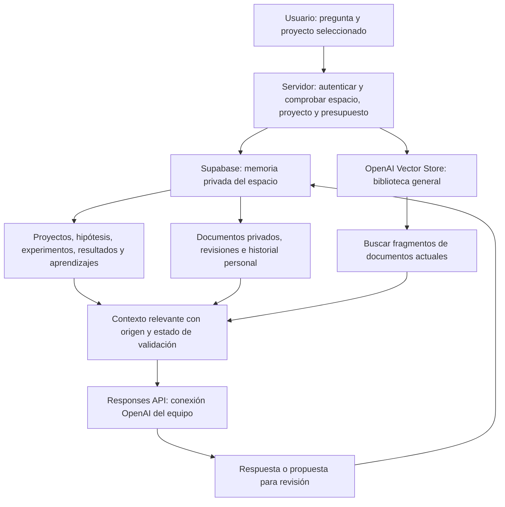

# Conocimiento general y memoria privada de Xperiments

## Resultado de la auditoría

La aplicación ya tenía autenticación y consultas de Supabase con el JWT del usuario, RLS por workspace, memoria compartida entre sus proyectos, originales privados, revisiones de fuentes y métricas estructuradas. Los disparadores de `20261015132501_workspace_ai_memory.sql` actualizan o retiran los fragmentos de búsqueda cuando cambian las fuentes. El chat conserva conversaciones personales y propuestas en Supabase; crear un experimento o validar un aprendizaje sigue requiriendo revisión humana.

La limitación principal era la biblioteca general: tres síntesis de libros se inyectaban desde el código en cada consulta. Ahora, cuando está configurado el almacén central, se utiliza exclusivamente su contenido vigente. El código anterior queda como compatibilidad para instalaciones que todavía no lo hayan configurado; no se usa como rescate de documentos eliminados ni durante una incidencia del almacén configurado.

## Flujo

## Decisión técnica

Se reutiliza OpenAI Vector Stores mediante su **Retrieval API** (`/vector_stores/{id}/search`), el motor que también utiliza File Search. La recuperación explícita permite mantener los esquemas de salida actuales, controlar los fragmentos y usar la biblioteca central aunque el equipo configure una clave de generación de otro proyecto de OpenAI. No se incorpora otro SDK, proveedor de vectores, microservicio ni llamada adicional de generación.

El servidor usa `OPENAI_SHARED_VECTOR_STORE_ID` y la credencial central `OPENAI_LIBRARY_API_KEY`, o `OPENAI_API_KEY` si no se separa. La conexión OpenAI de cada equipo sigue resolviéndose mediante `resolvedOpenAIKey`; no puede modificar ni elegir el almacén general. Ninguna de estas variables lleva prefijo `NEXT_PUBLIC_`.

La biblioteca existente se reutilizó sin volver a subir los documentos. Los tres archivos se identificaron como metodología, con título legible y `book_id`, conservando contenido e identificadores. Las investigaciones privadas de Imagine Builder permanecen en Supabase; no se promueven a conocimiento común.

## Actualizar la biblioteca general

El editor de Xperiments la administra en **OpenAI Platform → Storage → Vector stores → Xperiments · Biblioteca general**. No existe un endpoint público para modificarla: ser administrador de un workspace no concede permisos sobre la biblioteca de toda la plataforma.

1. Añadir el archivo al almacén central y esperar a que su indexación figure como completada. No hace falta cambiar la aplicación para añadir documentos.
2. Para sustituir contenido, añadir la nueva versión y retirar la anterior de ese mismo almacén. Los archivos de OpenAI no se editan como un documento de texto en la aplicación. Actualizar atributos de título o fecha tampoco sustituye el contenido.
3. Para retirar una referencia, eliminar su asociación al almacén. Borrar únicamente su copia local no la retira de OpenAI. La eliminación del archivo original de OpenAI es una operación distinta; no se realiza automáticamente desde Xperiments.
4. Atributos opcionales: `title`, `kind=methodology` para libros/métodos, `source_date` para fecha real de una investigación, `book_id` para referencias bibliográficas. Sin atributos, el archivo se considera referencia documental general, nunca un resultado de un equipo. La fecha de incorporación de un archivo no acredita actualidad de sus afirmaciones.
5. No cargar información privada en este almacén. Los archivos marcados `scope=private`, `visibility=private`, con identificadores de equipo/proyecto o `enabled=false` se excluyen de la recuperación. Los archivos nuevos sin atributos del almacén central se consideran generales deliberadamente.

Cada petición comprueba el catálogo completo que devuelve OpenAI, admite solo archivos completados y filtra los resultados por sus identificadores vigentes. Cuando una retirada ya figura en el catálogo, se excluye aunque el índice de búsqueda todavía devuelva el archivo. OpenAI propaga las operaciones de forma asíncrona: también se observó un breve retraso del catálogo y sus atributos en las pruebas reales. Las incorporaciones, sustituciones y retiradas se reflejan tras completar la indexación y propagarse el cambio del proveedor, no necesariamente en la primera consulta inmediatamente posterior al cambio. No hay una copia persistente en Xperiments que prolongue ese retraso. Una consulta ya en curso puede haber recuperado la versión anterior; no se cambia retrospectivamente su respuesta.

Las conversaciones originales se conservan. Al formar un contexto nuevo, se omiten las respuestas anteriores que dependían de referencias generales retiradas, para no reintroducirlas desde el historial. Esto no borra conocimientos generales que el modelo pudiera tener por su entrenamiento previo ni impide que el usuario vuelva a aportar un texto explícitamente.

## Memoria privada y aprendizaje

- Proyectos, objetivos, problemas, ideas, hipótesis, experimentos y aprendizajes continúan en `records`, con atribución a su proyecto y espacio.
- Métricas en `metric_observations`, recursos vinculados e instantáneas conservan procedencia, unidades y periodos. No se suman automáticamente ventanas superpuestas ni recursos padre/hijo.
- Conocimiento importado, revisiones, originales y fragmentos continúan en `ai_knowledge`, `ai_knowledge_revisions`, Storage y `ai_memory_chunks`. No se suben automáticamente al almacén general.
- Conversaciones en `ai_chat_entries`, visibles solo a su autor según las políticas existentes. No se publican al resto de miembros del espacio ni se convierten automáticamente en evidencia validada. Los aprendizajes que el usuario guarda sí enriquecen el conocimiento compartido del equipo.
- La selección prioriza el proyecto elegido sin dejar de recuperar aprendizajes pertinentes de otros proyectos del mismo espacio. El catálogo se pagina y el contexto enviado se acota y declara su cobertura.
- Cada respuesta distingue método, información documental, hipótesis, resultados observados y recomendaciones. Un aprendizaje revisado por una persona no demuestra por sí solo causalidad. Los experimentos anteriores pueden contradecir una recomendación general y deben tenerse en cuenta.

No se reentrena un modelo. Se actualiza la información recuperable y se selecciona el contexto necesario en cada consulta. Las solicitudes de generación siguen usando `store:false`; esa opción no convierte en temporales los archivos generales subidos deliberadamente a Vector Stores.

## Seguridad, costes y fallos

La autorización precede a la recuperación; se reserva el presupuesto antes de consultar OpenAI. No hay service role, nuevas tablas, migraciones ni cambios de RLS. Se mantienen las conexiones cifradas existentes, el límite estimado por workspace y la revisión de propuestas antes de crear recursos externos.

La búsqueda central está acotada a seis resultados, 3.200 caracteres por documento y 12.000 caracteres de extractos en total. Se comprueba el catálogo paginado antes de usarlos; un catálogo incompleto o una incidencia no se interpreta como un catálogo válido. Solo se consultan URLs fijas de `api.openai.com`, sin seguir redirecciones ni aceptar destinos o credenciales desde el cliente.

Una incidencia de la biblioteca no bloquea el contexto privado: se responde con las fuentes disponibles y una advertencia, sin atribuir a documentos lo que no se ha recuperado. No hay un caché global de respuestas o contexto de clientes. No se registran claves, preguntas ni textos de documentos en mensajes de error.

El almacén actual ocupaba aproximadamente 4,1 MB al conectarlo. OpenAI publica una franquicia de 1 GB agregado para almacenamiento de vectores; los precios y el consumo global deben revisarse en su panel. Se conserva el modelo económico existente. No se cambian planes de Vercel o Supabase ni se activan servicios de pago adicionales.

## Comprobaciones

- Pruebas de dos espacios: misma metodología general, claves separadas para recuperación/generación, contexto privado propio y citas permitidas.
- Altas, sustituciones y bajas simuladas; resultados de búsqueda antiguos se descartan y el historial no resucita referencias retiradas.
- Catálogo paginado, vacío, incompleto, credencial rechazada y fallos: no se inventa una biblioteca ni se filtran secretos.
- Mismo flujo en el chat y «Preparar con IA», preservando canal, materiales y esquemas de campañas.
- Recuperación real de documentos existentes, prueba autenticada en producción y controles de regresión del repositorio.

Fuentes oficiales: [Retrieval](https://developers.openai.com/api/docs/guides/retrieval), [File Search](https://developers.openai.com/api/docs/guides/tools-file-search), [precios](https://developers.openai.com/api/docs/pricing). La verificación real de un cambio de datos requiere comprobar el servicio desplegado, no solo aprobar las pruebas simuladas.

Validación previa al despliegue, 16 de octubre de 2026: 205 pruebas aprobadas y compilación de producción correcta. Se recuperaron fragmentos reales de los tres libros del almacén existente. Una biblioteca temporal aislada verificó alta, cambio de título, sustitución y retirada, esperando la propagación de OpenAI; se eliminaron los archivos y almacenes sintéticos creados para la prueba. Las comprobaciones autenticadas del servicio publicado se realizan después del despliegue.
