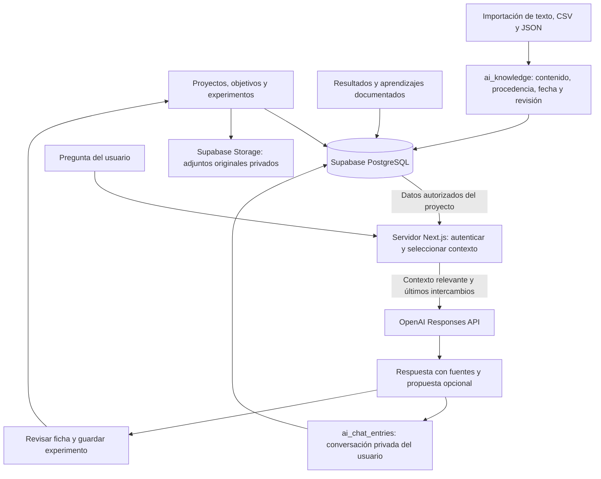

# IA estratégica de Xperiments

La sección IA aparece debajo de Documentar aprendizajes. El selector habitual elige el proyecto; cada proyecto mantiene su contexto y su memoria. El chat puede responder preguntas estratégicas, recuperar evidencia y proponer experimentos. La opción «Incluir otros proyectos de mi equipo» permite comparar información autorizada de varios proyectos del mismo workspace; nunca consulta otro equipo. La conversación y cualquier nueva propuesta continúan vinculadas al proyecto seleccionado. «Revisar y crear experimento» abre la ficha habitual; guardar usa los permisos y validaciones existentes. No se publica ninguna campaña desde el chat.

## Información persistente

- Se reutilizan `records`, `experiment_variants`, `external_resources` y `metric_observations`. Las métricas conservan sus periodos, unidades, moneda y recurso; el asistente no debe sumar observaciones solapadas ni atribuir causalidad a una simple comparación.
- `ai_knowledge` guarda texto cualitativo o tablas CSV/JSON, procedencia, fecha y estado de revisión humana. Importar no equivale a validar científicamente una conclusión. Los CSV son documentos de contexto: no se insertan automáticamente en métricas experimentales sin asociar recursos, fechas y unidades.
- `ai_chat_entries` conserva cada pregunta, respuesta, fuentes utilizadas, cobertura y propuesta. RLS permite leer/eliminar solo la conversación propia dentro de un equipo al que el usuario todavía pertenece. La interfaz muestra las últimas 30 consultas; se recuperan hasta seis para el siguiente turno. El historial no se trata como evidencia validada.
- La memoria importada se incluye en las copias de seguridad existentes. Las conversaciones privadas no se exportan en la copia compartida del equipo.
- Los archivos originales de experimentos permanecen en Storage privado. El chat inicial no procesa automáticamente sus imágenes, vídeos, PDF o DOCX: el usuario puede importar extractos de texto en TXT, CSV o JSON UTF-8 hasta 200 KB y 100.000 caracteres. La preparación de campañas mantiene su análisis de imágenes y fotogramas existente.

## Recuperación, seguridad y costes

En esta primera versión se consultan mediante SQL paginado todas las fichas, métricas, variantes, recursos y fuentes importadas del proyecto autorizado, o del workspace autorizado si el usuario marca la opción de otros proyectos. El contenido importado se divide en fragmentos de 2.000 caracteres. Se priorizan las coincidencias de la pregunta y la fecha, y se envía una selección de unos 28.000 caracteres más la descripción real del proyecto. Se muestra su cobertura y solo se aceptan citas a fuentes recuperadas. Cada fuente conserva su proyecto. No se utilizan embeddings, vectores ni entrenamiento propio. Al crecer significativamente el volumen convendrá sustituir la lectura del catálogo por búsqueda PostgreSQL indexada, manteniendo el mismo contrato de fuentes y permisos.

Las consultas usan el JWT del usuario y RLS, sin cliente service-role. Una clave compuesta y un trigger impiden vincular memoria/conversaciones a otro equipo o a fichas que no son proyectos. Crear conocimiento requiere permiso `learnings.create`; eliminarlo requiere `learnings.delete`. Crear propuestas exige `experiments.create`; cualquier miembro autorizado puede preguntar. La clave OpenAI permanece en el servidor.

Se utiliza el mismo modelo y clave de la preparación existente: `gpt-4.1-mini-2025-04-14`, Responses API, `store:false`, salidas JSON estructuradas, límite de salida y timeout. El contexto importado también se recupera en Preparar con IA de la ficha. La reserva de chat comparte el bloqueo, los IDs de solicitudes, el intervalo de 15 segundos y el presupuesto mensual existente de 5 USD del equipo, con 0,03 USD por petición incluso fallida. Esta reserva es una estimación conservadora, no una factura de OpenAI. Guardar información no llama a OpenAI.

## Mascota

`public/einstein-ia.webp`: ilustración de Einstein generada con imagegen incorporado, fondo transparente, optimizada en WebP conservando alfa. Animación CSS ligera de movimiento, destellos y aparición de aprendizaje; respeta `prefers-reduced-motion`.

Prompt exacto utilizado con la herramienta incorporada imagegen:

> Create a charming funny cartoon Albert Einstein mascot for a Spanish growth experimentation app. Transparent background, clean high-quality illustrated bitmap cutout. Friendly older scientist with fluffy wild white hair and moustache, expressive eyebrows, round nose, small lab coat, navy blue trousers, lime accents. Full body seated/standing behind a small simple navy lab bench, holding a lime bubbling flask in his left hand and an open notebook in his right, excited learning expression. Bright lime green, sky blue and small red science details, readable at 240px. One cohesive character, isolated centered composition, no words, no logos, no surrounding scenery, no photorealism, genuinely transparent alpha.

La aplicación muestra el archivo guardado; no requiere llamadas a un servicio de generación de imágenes.

## Activación y comprobación

La migración `20261013152250_ai_project_memory.sql` se aplica por separado del despliegue. Comprobar tablas con RLS y sus políticas, y `public.reserve_ai_chat` como invocador. Pruebas de la cadena completa cubren equipos ajenos, proyectos cruzados, lectores, autores falsificados, conversaciones privadas, presupuesto compartido y duplicación de solicitudes. Las pruebas de la ruta cubren autenticación, contexto acotado, ausencia de claves en el prompt, citas autorizadas y guardado privado de la respuesta.

Comprobación real realizada el 13/10/2026 en producción: importación de un archivo JSON con observaciones cualitativas y cifras ficticias, recuperación y cita de su fuente en el chat, propuesta A/B, apertura de la ficha habitual, revisión humana y guardado con dos variantes. También se verificó que cambiar de Greenhunt a Greenroute cambiaba conversación y memoria, y que el historial persistía al volver al proyecto. La fuente, conversación y experimento creados para la prueba fueron retirados después de comprobarlos. La migración quedó aplicada y se verificó que ambas tablas tienen RLS y tres políticas, y que el RPC público de presupuesto es invocador. Una propuesta con parámetros opcionales inválidos conserva la respuesta y los campos comunes válidos, muestra una advertencia y descarta la configuración de ejecución inválida para revisión.
