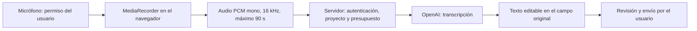

# Dictado por voz

Disponible en el chat estratégico de IA, en «Describe el experimento» de Preparar con IA y en las respuestas de seguimiento que pide ese asistente.

1. Pulsa el botón de micrófono «Dictar» y permite el micrófono cuando lo solicite tu navegador.
2. Habla durante un máximo de 90 segundos. Puedes cancelar sin añadir texto.
3. Pulsa «Terminar y transcribir». Se libera el micrófono y se prepara el texto.
4. Revisa o edita el texto añadido al campo. Envía la consulta o solicita la propuesta cuando lo decidas.

El dictado añade texto y conserva lo que ya habías escrito. Si supera el límite del campo, se conserva una transcripción editable para acortarla antes de añadirla; no se trunca silenciosamente. Si la conexión falla, se ofrece reintentar con el audio temporal. Cerrar la sección, cambiar de proyecto o cancelar libera las pistas y descarta las operaciones pendientes para que no añadan texto en otro contexto.

## Arquitectura

El audio se mantiene temporalmente en el navegador durante el dictado y los reintentos. No se guarda en Supabase Storage, en las fichas ni en el historial del chat. Se envía a OpenAI al terminar para transcribirlo; las condiciones de conservación del proveedor son independientes. El texto entra en el flujo habitual solo cuando el usuario elige enviarlo o guardar su ficha. La página de privacidad incluye este tratamiento.

Se usa `gpt-4o-mini-transcribe-2025-12-15` mediante `/v1/audio/transcriptions`, con la misma conexión OpenAI privada del equipo. La clave permanece en el servidor. No hay traducción automática ni conversación de voz en tiempo real. El formato se normaliza en el navegador para evitar que una duración declarada por el cliente permita saltarse los límites: el servidor valida cabecera, longitud y duración real de las muestras PCM, y rechaza silencio o señal demasiado baja antes de consumir presupuesto.

El archivo máximo es 2.880.044 bytes más un margen de 65.536 bytes para multipart, por debajo del límite de entrada de Vercel. La ruta usa Node.js, tiempo máximo de 60 s y timeout del proveedor de 35 s. No requiere paquetes nuevos ni cambios de plan.

## Presupuesto y permisos

La migración `20261013190416_ai_voice_budget.sql` comparte el límite mensual existente de 5 USD del workspace y una reserva conservadora de 0,03 USD por transcripción enviada, incluso fallida. Se registra únicamente modelo, usuario, solicitud y reserva, sin audio ni transcripción.

Transcripción y razonamiento tienen ventanas de frecuencia independientes de 15 s, manteniendo el mismo bloqueo y presupuesto total. Así se puede transcribir y pedir la propuesta inmediatamente sin esperar por la reserva de audio. Las solicitudes repetidas con el mismo ID se rechazan. Para el chat se exige pertenencia al equipo; para el asistente de experimentos se comprueban permisos de creación o edición. Todos los RPC públicos de reserva son invocadores; el código privilegiado permanece en el esquema privado y comprueba pertenencia y modelo permitido.

## Comprobaciones

Las pruebas cubren permisos, proyecto ajeno, autenticación, errores de proveedor sin exposición de claves, tamaño real incluso sin Content-Length, formato y duración falsificados, silencio, conservación de texto previo y límites, cancelación durante el permiso y liberación de pistas. También se prueba que un evento tardío de una grabación cancelada no cierre un nuevo micrófono.

Se probó la API real de OpenAI con un audio sintético en español, normalizado con la misma función que usa el dictado. Devolvió: «Crea un experimento con dos variantes para Greenhunt. Quiero comparar una imagen con un vídeo.». Esta prueba no utiliza el micrófono físico del usuario.

Referencias: [transcripción de OpenAI](https://developers.openai.com/api/docs/guides/speech-to-text), [modelo utilizado](https://developers.openai.com/api/docs/models/gpt-4o-mini-transcribe), [MediaRecorder](https://developer.mozilla.org/en-US/docs/Web/API/MediaRecorder), [permiso de micrófono](https://developer.mozilla.org/en-US/docs/Web/API/MediaDevices/getUserMedia).
