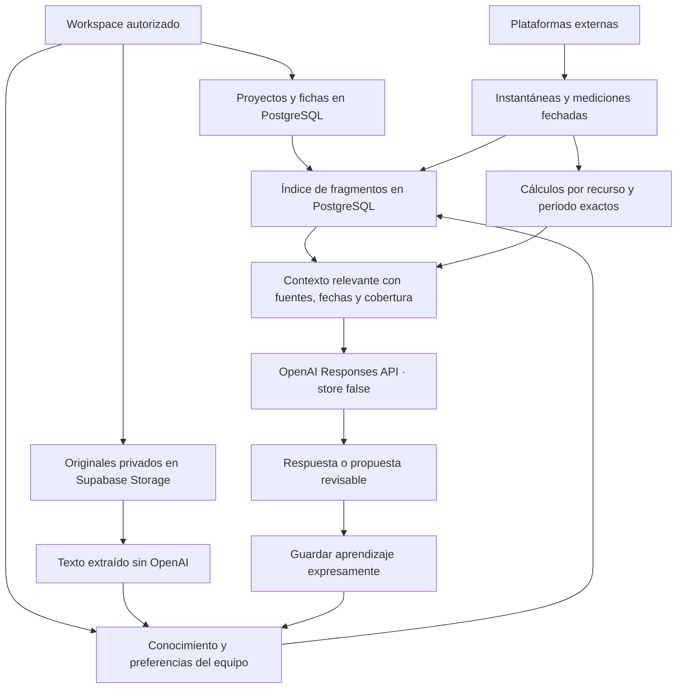

# IA compartida del espacio de trabajo

La unidad de memoria es el workspace; los proyectos conservan sus fichas, experimentos,
GOI y aprendizajes. Las fuentes llevan su proyecto de origen o project_id null cuando
son conocimiento general del equipo. Las conversaciones siguen siendo personales.
Cambiar el proyecto de destino no cambia la memoria ni borra la conversación.

## Almacenamiento y búsqueda

- `records` mantiene las fichas originales; no se cambian sus IDs ni proyectos.
- `ai_knowledge` admite fuentes generales o procedentes de un proyecto. Se distinguen
  notas, investigación, preferencias del equipo y aprendizajes propuestos.
- `ai_memory_chunks` es un índice reconstruible con fragmentos solapados, búsqueda
  de texto en español e inglés e índices GIN. Los cambios de las fuentes actualizan
  el índice; archivar una fuente la excluye de nuevas consultas y es reversible.
- Se recuperan hasta 60 candidatos y se selecciona contexto acotado; no se descarga
  toda la historia en cada pregunta. La interfaz informa la cobertura en fragmentos.
  Es búsqueda textual, sin embeddings ni entrenamiento de modelos.
- Preferencias revisadas reciben prioridad; no se convierten en instrucciones del
  sistema. Las conclusiones de un proyecto solo sugieren hipótesis para otro.
- `ai_chat_entries` conserva preguntas y respuestas bajo RLS del usuario. El chat no
  se comparte como evidencia. Hay un botón explícito para proponer un aprendizaje.

## Documentos y revisión

Los originales nuevos se conservan en el bucket privado `ai-documents`. TXT, CSV,
JSON, Markdown, PDF con texto y DOCX se extraen localmente en el servidor, sin IA.
Los documentos de fichas siguen en `record-attachments`; se pueden indexar sin
duplicar el original. Los PDF/DOCX añadidos a fichas intentan indexarse si el autor
tiene permiso para crear conocimiento. Hay una acción para indexar los anteriores.

Los archivos admiten hasta 10 MB; la extracción admite 100.000 caracteres y hasta
200 páginas PDF. No se trunca silenciosamente: si no puede extraerse el texto completo,
el original permanece y se indica que necesita una copia legible o dividida.
No se hace OCR ni transcripción automática de imágenes/vídeos: se conservan y pueden
analizarse en una consulta, guardando después el análisis expresamente.

Fuentes: sin verificar, revisadas por persona o cuestionadas por nueva evidencia.
Se conserva procedencia, evidencia, fecha, revisor y versiones anteriores en
`ai_knowledge_revisions`. Revisar no demuestra causalidad. Las fichas antiguas no
adquieren validación científica automáticamente.

## Resultados numéricos

Consultas de recursos vinculados de Meta, Google Ads, Smartlead, Metricool y PostHog
guardan una instantánea cuando el usuario tiene permiso para editar experimentos.
Las vistas previas sin vincular y las consultas de lectores no escriben resultados.
Los fallos de persistencia se comunican; no deben confundirse con una consulta fallida.

`provider_result_snapshots` conserva revisiones con fecha, recurso, periodo y huella;
la misma respuesta en el mismo día no duplica la instantánea. Las mediciones
normalizadas se actualizan por recurso/métrica/periodo; el historial bruto permanece.
La importación es iniciada por el usuario, bajo su JWT (`source=manual`); las notas
identifican al proveedor. No se conceden permisos para falsificar el escritor API
protegido ni se añade una clave service_role. Las instantáneas registran información
importada autorizada, no evidencia firmada criptográficamente por el proveedor.

`workspace_metric_facts` calcula CTR, CPC y respuestas/correos solo con datos del
mismo recurso y periodo exactos. No suma campañas y anuncios, monedas, periodos
superpuestos ni snapshots acumulados. Los denominadores ausentes o cero devuelven
null. PostHog conserva su análisis calculado por el proveedor; no se inventan
conversiones ni significancia a partir de medias.

La sincronización manual del equipo pagina recursos en lotes de dos. Consulta los
últimos siete días; Metricool busca publicaciones de los últimos 30 días y conserva
sus acumulados, no atribuye las interacciones a ese rango. Los errores de cada
proveedor son visibles y no borran información anterior. No hay cron ni nuevas
cuentas de pago. Proveedores no conectados pueden seguir usando importación manual.

## Seguridad, exportación y límites de la verificación

RLS y permisos del backend mantienen aislados equipos, fuentes, búsquedas, archivos
y métricas. El índice excluye credenciales y configuración privada de integraciones.
La migración desactiva la vista pública del workspace real; no altera sus datos.
OpenAI recibe contexto seleccionado y adjuntos de la consulta; `store:false` no es
una promesa de retención cero por parte del proveedor.

La exportación versión 8 incluye conocimiento, revisiones, instantáneas, documentos,
perfiles de integración y preparaciones de proveedores. Con originales, el ZIP
incluye los archivos de fichas y memoria; falla si un original está incompleto.
Credenciales y conversaciones de otros usuarios permanecen excluidas. El índice
es derivado y no necesita exportarse. No hay restauración automática de PostgreSQL:
el ZIP conserva datos/relaciones/bytes para recuperación, sin sustituir una política
de copias externas con ejercicios periódicos de restauración.

Las pruebas SQL cubren aislamiento entre dos equipos, lectores, documentos privados,
procedencia por proyecto, archivado, revisión y cálculos deterministas. Las pruebas
de archivos extraen PDF/DOCX reales y verifican los bytes en la copia ZIP. No afirman
haber verificado campañas activas ni resultados causales de las plataformas externas.

## Comprobación en producción del 15/10/2026

Las tres migraciones se aplicaron y verificaron en Supabase; el despliegue Vercel
del commit 128497e terminó correctamente. La vista pública devuelve null, el bucket
de originales es privado y los avisos de seguridad no aumentaron respecto al estado
anterior. Los 276 fragmentos iniciales se indexaron conservando los registros fuente.

Desde la interfaz se guardó una fuente sintética general con Greenhunt seleccionado.
Al cambiar a Greenroute se conservaron el historial y la fuente. La consulta real a
OpenAI recuperó el código sintético solicitado, citó la fuente general y explicó que
no probaba resultados de ninguno de los dos proyectos. La respuesta quedó guardada
con scope workspace. Después se archivó la fuente: quedó fuera del índice y conservó
una revisión recuperable. No se alteraron datos de investigación reales.

La extracción PDF/DOCX, copia ZIP con originales y recuperación de una indexación
interrumpida se verificaron en pruebas de servidor. La subida completa por Chrome
quedó pendiente: la extensión exigió acceso a URLs de archivo y la sesión posterior
no ofrecía pestañas controlables. No se presenta esa prueba de navegador como pasada.
